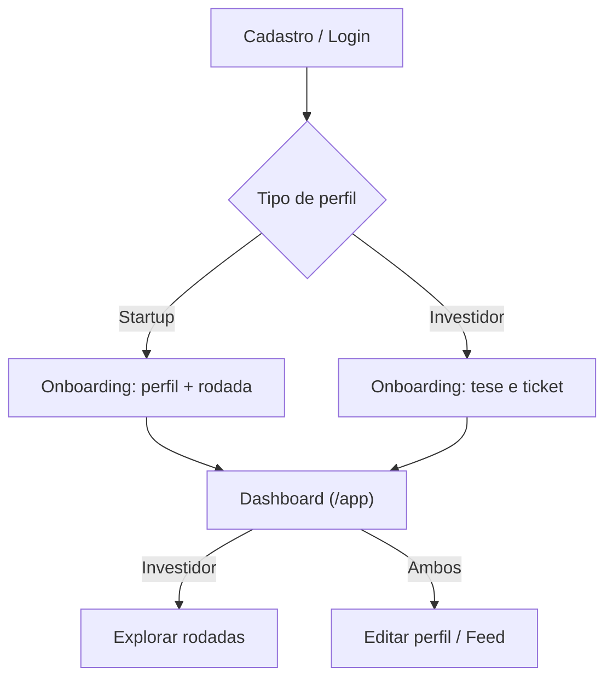

<p align="center">
  
</p>

<h1 align="center">ALTURA</h1>

<p align="center">
  <strong>Plataforma de matchmaking entre Startups e Investidores</strong><br>
  <em>Projeto Integrador 2026.2 • UE: FullStack • Senac</em>
</p>

<p align="center">
  
  
  
  
  
</p>

---

## 💡 Visão Geral

A **ALTURA** conecta **startups com tração em busca de captação** a **investidores com teses alinhadas**. Com perfis estruturados, métricas mensais (receita, MRR, clientes, crescimento), filtros avançados e um catálogo de rodadas abertas, a plataforma reduz o tempo de busca no ecossistema de inovação.

- **Startups:** visibilidade qualificada e apresentação padronizada de tração.
- **Investidores:** *dealflow* curado, focado em startups com tração comprovada.

O frontend é uma SPA em **React 19 + TypeScript**; o **Spring Boot 3** cuida de autenticação, validações e API, com **PostgreSQL (Neon)**.

---

## ✅ Funcionalidades

- **Landing page:** hero, como funciona, trilhas por público, segmentos, FAQ e CTA.
- **Autenticação:** cadastro/login por e-mail e senha com papel (Startup ou Investidor), BCrypt, JWT curto e refresh token rotativo.
- **Onboarding:** formulário por papel validado com Zod (CNPJ/CPF, segmentos, rodada, tração ou ticket), com rascunho automático em `localStorage`.
- **Dashboard e perfil:** visão geral por papel, edição de perfil e prévia de como o perfil aparece para o outro lado.
- **Exclusão de perfil:** diálogo com confirmação em duas etapas; remove o perfil (a conta de acesso permanece) e redireciona ao onboarding.
- **Explorar rodadas (investidor):** listagem com filtros (nome, segmento, ticket, equity mínimo), cards de oportunidade e modal com detalhes e vídeo de pitch.
- **Feed de tração:** publicações com categorias, métrica em destaque, imagem ou vídeo do YouTube, curtidas e comentários.

### Imagens do feed

As imagens ficam em um bucket privado do **Neon Object Storage** (o banco guarda só a chave) e são servidas por URL assinada temporária. Antes do upload, o navegador reduz a imagem para no máximo 1600 px e converte para WebP (meta ~500 KB, limite 1 MB). O backend revalida MIME, assinatura binária e tamanho.

Variáveis necessárias em `backend/.env` (nunca no frontend):

```dotenv
AWS_ENDPOINT_URL_S3=https://SEU-ENDPOINT-DE-STORAGE
AWS_REGION=us-east-2
AWS_ACCESS_KEY_ID=...
AWS_SECRET_ACCESS_KEY=...
STORAGE_BUCKET=altura-feed
STORAGE_SIGNED_URL_MINUTES=60
```

Sem elas, a API funciona para texto e YouTube, mas recusa o envio de imagens.

---

## 🔄 Fluxo Principal



---

## 🧭 Rotas

| Rota | Página | Acesso |
| :--- | :--- | :--- |
| `/` | Landing page | Público |
| `/login` | Login | Público |
| `/cadastro`, `/cadastro/startup`, `/cadastro/investidor` | Cadastro | Público |
| `/onboarding` | Onboarding de perfil | Autenticado (sem perfil) |
| `/app` | Dashboard | Autenticado |
| `/editar-perfil` | Editar perfil | Autenticado |
| `/explorar-rodadas` | Explorar rodadas | Investidor |
| `/feed` | Feed de tração | Autenticado |

Estados de autenticação: `loading` → `signedOut` → `needsProfile` → `ready`.

---

## 🛠 Stack

- **Frontend:** React 19, TypeScript, Vite 6, Tailwind CSS 4, Zod 4, lucide-react.
- **Backend:** Java 17, Spring Boot 3, Spring Security, Spring JDBC, JWT, BCrypt.
- **Banco:** PostgreSQL no Neon (acesso só pelo backend, via TLS).
- **Schema:** `database/nexo_schema.sql`. Para notificações em banco existente, execute `database/20261016_notifications.sql` no Neon antes de reiniciar a API.

---

## 📂 Estrutura

```text
altura/
├── backend/     # API Spring Boot e repositórios JDBC
├── database/    # Schema e migrations PostgreSQL
├── docs/        # openapi.yaml
├── public/      # Assets estáticos
└── src/
    ├── auth/        # Contexto e API de autenticação
    ├── components/  # Páginas e componentes de UI
    ├── data/        # Dados e tipos
    ├── lib/         # Cliente HTTP e contratos da API
    ├── utils/       # Documentos, localização, vídeos, imagens
    └── App.tsx      # Roteamento (History API)
```

---

## 📖 API

Com o backend rodando: Swagger UI em `http://localhost:8080/swagger-ui.html` e OpenAPI JSON em `http://localhost:8080/v3/api-docs`.

---

## ⚖ LGPD

O projeto segue *Privacy by Design* (Lei nº 13.709/2018): coleta mínima de dados, controle de acesso pelo `sub` do JWT, senhas em BCrypt, refresh tokens em SHA-256 e direitos do titular via edição e exclusão de perfil.

---

## 💻 Como Executar

Pré-requisitos: Node.js 20+, npm, Java 17 e Maven 3.9+.

```bash
git clone https://github.com/kiellzz/altura.git
cd altura_p.i_2026.2
npm install

# Frontend: crie .env com VITE_API_URL=http://localhost:8080/api
# Backend: configure backend/.env a partir de backend/.env.example

cd backend && mvn spring-boot:run   # terminal 1
npm run dev                         # terminal 2 (na raiz)
```

Acesse `http://localhost:5173`. Scripts: `npm run dev`, `npm run build` (tsc + build) e `npm run preview`.

---

## 👥 Equipe

Pedro Henrique Maciel • Hugo Dantas • Roberto Alves • Cleybson Teixeira • Ezequiel Borges • Eduardo Soares

*Orientação: Prof. Geraldo Gomes*