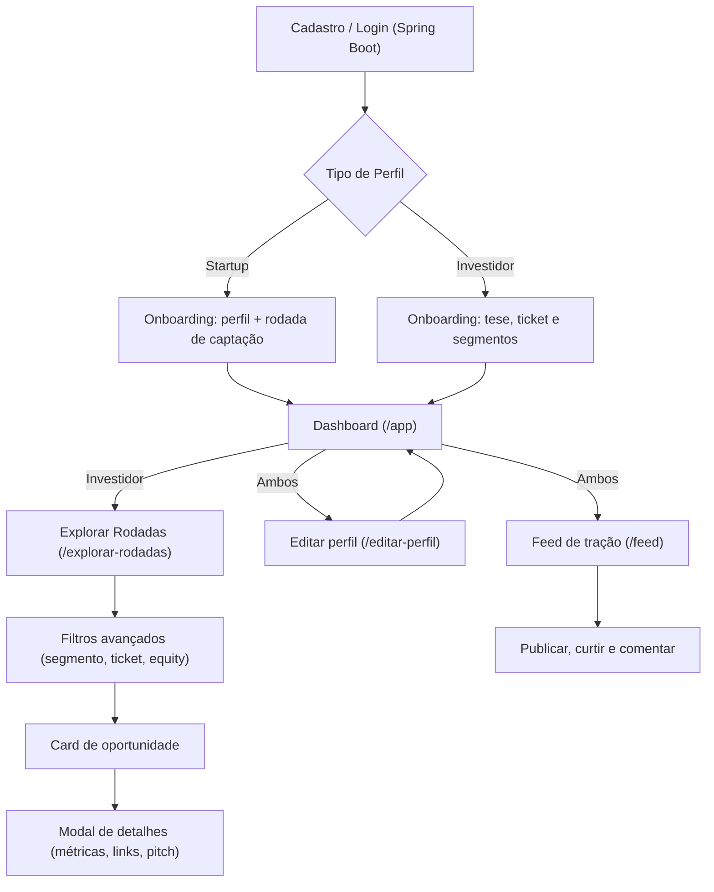
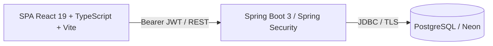

<p align="center">
  
</p>

<h1 align="center">ALTURA</h1>

<p align="center">
  <strong>Plataforma Inteligente de Matchmaking entre Startups e Investidores</strong><br>
  <em>Projeto Integrador 2026.2 • UE: FullStack • Senac</em>
</p>

<p align="center">
  
  
  
  
  
  
  
  
</p>

---

## 📌 Sumário

- [Visão Geral](#-visão-geral)
- [Proposta de Valor e Público-Alvo](#-proposta-de-valor-e-público-alvo)
- [Funcionalidades Atuais](#-funcionalidades-atuais)
- [Fluxo Principal da Solução](#-fluxo-principal-da-solução)
- [Rotas da Aplicação](#-rotas-da-aplicação)
- [Arquitetura e Tecnologias](#-arquitetura-e-tecnologias)
- [Modelo de Dados](#-modelo-de-dados)
- [Estrutura do Repositório](#-estrutura-do-repositório)
- [Documentação da API (OpenAPI)](#-documentação-da-api-openapi)
- [Governança e Conformidade LGPD](#-governança-e-conformidade-lgpd)
- [Como Executar o Projeto](#-como-executar-o-projeto)
- [Equipe](#-equipe)

---

## 💡 Visão Geral

A **ALTURA** é uma plataforma web responsiva que conecta **startups em tração em busca de captação** a **investidores com teses alinhadas**.

Por meio de perfis estruturados, métricas mensais de tração (receita, MRR, clientes, pilotos e crescimento), filtros avançados e um catálogo qualificado de rodadas abertas, a plataforma reduz o atrito e o tempo de busca no ecossistema de inovação.

O frontend é uma **SPA em React 19 + TypeScript** com roteamento próprio (History API). O **Spring Boot 3** concentra autenticação, autorização, validações e a API, com persistência em **PostgreSQL hospedado no Neon**.

---

## 🎯 Proposta de Valor e Público-Alvo

### Proposta de Valor
* **Para Startups:** Visibilidade qualificada para investidores-anjo e fundos, apresentação padronizada de tração e redução do tempo de captação.
* **Para Investidores:** Curadoria de *dealflow* com foco exclusivo em startups com **tração comprovada**, combinando evidências recentes, segmento, ticket e equity.

### Público-Alvo
1. **Startups & Empreendedores:** negócios com **tração comprovada**, mercado validado e sinais mensuráveis, em busca de *smart money*.
2. **Investidores & Fundos:** investidores-anjo, *family offices*, corporativos e fundos de *Venture Capital (VC)*.

---

## ✅ Funcionalidades Atuais

### Landing Page
- **Hero** com vídeo de destaque e cartão de prévia de rodada.
- **Como funciona** (jornada em 3 passos), **Trilhas por público** (startup/investidor), **Segmentos** suportados, **FAQ** e **CTA final**.
- Cabeçalho responsivo com navegação e menu mobile.

### Autenticação (Spring Security)
- **Cadastro** e **Login** por e-mail/senha, com seleção de papel (**Startup** ou **Investidor**) no cadastro.
- Senhas protegidas com **BCrypt**, JWT de acesso com curta duração e refresh token rotativo.
- Sessão persistida no navegador, renovada automaticamente e sincronizada entre abas.

### Onboarding
- Formulário de perfil específico por papel, com validação via **Zod**:
  - **Startup:** responsável, nome, **CNPJ** (validação de dígitos verificadores), segmento principal, **segmentos secundários (opcional)**, descrição, vídeo de pitch, localização, **rodada de captação** e **sinais mensais de tração** (receita, MRR, clientes, pilotos, crescimento e evidência descritiva), sempre com referência dentro dos últimos 12 meses.
  - **Investidor:** nome, **CPF** (validação), tipo, biografia, faixa de ticket (mín./máx.) e segmentos de interesse.
- **Rascunho automático** dos formulários em `localStorage` (por usuário e tipo).

### Perfil & Dashboard
- **Editar perfil** (`/editar-perfil`) para ambos os papéis, reaproveitando o mesmo motor de validação/persistência do onboarding.
- **Dashboard** (`/app`) com visão geral adaptada ao papel (rodadas/captação para startup; conexões/investimentos/startups para investidor) e ações rápidas.
- **Prévia de perfil** (`StartupProfilePreview` / `InvestorProfilePreview`) mostrando exatamente como o perfil é exibido para o outro lado.

### Exclusão de Perfil (CRUD — Create, Read, Update, **Delete**)
- **Entrada:** botão **Excluir perfil** no nav do dashboard (`dashboard-actions` do `AppPlaceholder`), ao lado de *Editar perfil* e *Sair*, de forma **discreta** (só texto/ícone, `button-danger-ghost`, com fundo de alerta apenas no hover) dentro da paleta do projeto. Implementado no componente reutilizável `components/ExcluirPerfil.tsx`.
- **Confirmação em duas etapas:** o clique abre um diálogo (`role="alertdialog"`) explicando o que será perdido — para startup, *suas rodadas de captação e os matches recebidos*; para investidor, *seus segmentos de interesse e as propostas enviadas* — e exige o checkbox **"Entendo que essa ação não pode ser desfeita"** para habilitar o botão de confirmação.
- **Persistência:** `excluirPerfilStartup()` e `excluirPerfilInvestidor()` chamam a API autenticada; o backend deriva o usuário do JWT e apaga somente o perfil correspondente. Erros são exibidos **dentro do diálogo**, mantendo o usuário na tela; o botão mostra *Excluindo...* durante a operação.
- **Armazenamento atual:** a exclusão remove o perfil e seus relacionamentos do PostgreSQL por cascata; a conta de acesso permanece.
- **Pós-exclusão:** `refresh()` do `useAuth()` faz o `status` voltar a `needsProfile`, o que redireciona ao `/onboarding?aviso=perfil-excluido` com a mensagem *"Perfil excluído. Você pode criar um novo perfil quando quiser."* (o parâmetro é removido da URL após a leitura).
- **Escopo:** é exclusão do **perfil**, não da conta autenticada.

**Roteiro de teste manual:**
1. Com uma **startup de teste**, abra o dashboard → *Excluir perfil* → confirme pelo diálogo → caia no `/onboarding` com a mensagem.
2. Repita com um **investidor** e confirme que o usuário volta ao `/onboarding`.
3. Cancelar (botão, backdrop ou `Escape`) e checkbox desmarcado não excluem nada; refresh em `/onboarding` não repete a mensagem.

### Explorar Rodadas (Investidor)
- Listagem de **rodadas abertas de startups com tração**, carregadas pela API Spring Boot.
- **Filtros avançados** em painel dedicado: busca por nome, segmento, faixa de ticket (RangeSlider) e equity mínimo, com botão **Limpar filtros** que se habilita só quando há filtro ativo.
- **Cards de oportunidade** padronizados com rodada e resumo das métricas reais mais recentes.
- **Modal de detalhes** com sobre a startup, **segmentos secundários** (com ícones), informações adicionais (localização, site, LinkedIn) e **vídeo de pitch** (embed do YouTube).

### Feed de Tração
- Feed autenticado para startups e investidores em `/feed`, com publicações persistidas no PostgreSQL.
- Categorias de **Atualização**, **Conquista**, **Rodada/Captação** e **Tese/Insight**.
- Destaque opcional de métrica, como MRR, receita, clientes ou crescimento mensal.
- Uma mídia opcional por publicação: **imagem comprimida** ou **vídeo por URL do YouTube**.
- Curtidas, comentários e exclusão de publicação restrita ao próprio autor.
- Identidade visual responsiva do Nexo, incluindo tema escuro e estados de carregamento/erro/vazio.

### Mídias do feed e compressão de imagens

As imagens do feed **não são armazenadas em Base64 nem dentro do PostgreSQL**. O banco guarda
somente `imagem_chave`, enquanto os bytes ficam em um bucket privado do **Neon Object Storage**.
Na leitura do feed, o Spring Boot gera uma URL assinada temporária. Vídeos não são reenviados:
somente o ID validado de 11 caracteres é salvo e o player usa `youtube-nocookie.com`.

Fluxo de uma imagem:

1. O navegador aceita JPG, PNG ou WebP com até **5 MB**.
2. `utils/imagemFeed.ts` preserva a proporção e reduz o maior lado para, no máximo, **1600 px**.
3. O canvas converte a imagem para **WebP** e tenta qualidades decrescentes (`0.86` a `0.54`),
   buscando aproximadamente **500 KB** e recusando o resultado caso ultrapasse **1 MB**.
4. O backend recebe a publicação e o arquivo juntos em `multipart/form-data`, confere MIME,
   assinatura binária e tamanho, e envia o arquivo ao bucket antes de inserir a postagem.
5. Se a inserção no banco falhar, o arquivo recém-enviado é removido. Ao excluir uma postagem,
   o backend também tenta apagar seu objeto no bucket.

Essa compressão reduz armazenamento e tráfego sem deformar a imagem. Ela ocorre antes do upload,
então uma foto original de 5 MB normalmente envia apenas algumas centenas de KB. O limite de
1 MB também é repetido em `spring.servlet.multipart.max-file-size`, pois validação no navegador
não substitui validação no servidor.

Variáveis de backend necessárias para imagens:

```dotenv
AWS_ENDPOINT_URL_S3=https://SEU-ENDPOINT-DE-STORAGE
AWS_REGION=us-east-2
AWS_ACCESS_KEY_ID=...
AWS_SECRET_ACCESS_KEY=...
STORAGE_BUCKET=altura-feed
STORAGE_SIGNED_URL_MINUTES=60
```

Crie `altura-feed` como bucket **privado** no projeto/branch do Neon e copie as variáveis S3
geradas pelo Neon para `backend/.env`. Sem elas, a API continua funcionando para texto e YouTube,
mas responde com indisponibilidade quando uma imagem é enviada. Nunca coloque essas credenciais
em uma variável `VITE_*` ou no frontend.

### Utilidades transversais
- Validação e máscara de **CPF/CNPJ** (`utils/documentos.ts`).
- Validação de **URLs** (YouTube, site e LinkedIn) (`utils/videos.ts`).
- **Geocodificação reversa** via Nominatim/OpenStreetMap para preencher cidade/estado (`utils/localizacao.ts`).
- **Ícones por segmento** (`SegmentIcon`), **RangeSlider** acessível e componentes de UI reutilizáveis.

---

## 🔄 Fluxo Principal da Solução



---

## 🧭 Rotas da Aplicação

O roteamento é feito no cliente (History API) em `src/App.tsx`, com proteção de rotas por status de autenticação.

| Rota | Página | Acesso |
| :--- | :--- | :--- |
| `/` | Landing page | Público |
| `/login` | Login | Público (redireciona se já logado) |
| `/cadastro` | Cadastro (papel via `?tipo=`) | Público |
| `/cadastro/startup` | Cadastro de Startup | Público |
| `/cadastro/investidor` | Cadastro de Investidor | Público |
| `/onboarding` | Onboarding de perfil | Autenticado (sem perfil) |
| `/app` | Dashboard | Autenticado |
| `/editar-perfil` | Editar perfil | Autenticado |
| `/explorar-rodadas` | Explorar rodadas | Autenticado (investidor) |

**Estados de autenticação:** `loading` → `signedOut` → `needsProfile` → `ready`. Rotas protegidas exigem `ready`; usuários sem perfil são enviados ao `/onboarding`.

Após a **exclusão de perfil** pelo nav do dashboard, o usuário cai em `/onboarding?aviso=perfil-excluido` e vê a mensagem *"Perfil excluído. Você pode criar um novo perfil quando quiser."*

---

## 🛠 Arquitetura e Tecnologias



### Stack Tecnológica
* **Frontend:** [React 19](https://react.dev/), [TypeScript](https://www.typescriptlang.org/), [Vite 6](https://vite.dev/), [Tailwind CSS 4](https://tailwindcss.com/) + CSS customizado.
* **Backend:** Java 17, Spring Boot 3, Spring Security Resource Server, Spring JDBC, WebSocket autenticado, BCrypt, JWT e validação Jakarta.
* **Persistência:** PostgreSQL no Neon, acessado somente pelo backend via conexão TLS e pool HikariCP.
* **Validação:** [Zod 4](https://zod.dev/) nos formulários de perfil.
* **Ícones:** [lucide-react](https://lucide.dev/) + SVGs próprios.
* **Tipografia:** `@fontsource-variable` (Inter e Plus Jakarta Sans).

---

## 🗄 Modelo de Dados

O modelo contempla usuário, refresh token, startup, investidor, segmentos, rodada, métricas de tração, matches, feed, conversas e notificações. O esquema completo está em `database/nexo_schema.sql`; os repositórios JDBC ficam em `backend/src/main/java/com/altura/api/repository`.

Para adicionar notificações a um banco já existente, execute `database/20261016_notifications.sql` no SQL Editor do Neon antes de reiniciar a API. A migration registra novas conexões e mudanças de status, mensagens, curtidas e comentários; interações anteriores à execução não são preenchidas retroativamente.

Senhas são persistidas exclusivamente como BCrypt e refresh tokens exclusivamente como SHA-256. O navegador nunca recebe credenciais do PostgreSQL.

---

## 📂 Estrutura do Repositório

```text
altura/
├── backend/                    # API Spring Boot, autenticação e repositórios JDBC
├── database/                   # Migration PostgreSQL completa
├── public/                     # Assets estáticos (favicon, imagem genérica, robots)
├── src/
│   ├── assets/                 # Imagens, vídeos e SVGs
│   ├── auth/                   # AuthContext, AuthProvider, authApi e hook useAuth
│   ├── components/             # Componentes de UI e páginas
│   │   ├── AuthPage.tsx            # Login e cadastro
│   │   ├── OnboardingPage.tsx      # Onboarding de perfil
│   │   ├── EditProfilePage.tsx     # Edição de perfil
│   │   ├── AppPlaceholder.tsx      # Dashboard principal (nav com Editar/Excluir perfil e Sair)
│   │   ├── ExcluirPerfil.tsx       # Botão + diálogo de confirmação da exclusão de perfil
│   │   ├── ExplorarRodadasPage.tsx # Catálogo de rodadas + filtros + modal
│   │   ├── StartupProfilePreview.tsx / InvestorProfilePreview.tsx
│   │   ├── Hero / HowItWorks / AudiencePaths / Segments / Faq / FinalCta / Header / Footer
│   │   ├── SegmentIcon.tsx         # Ícone por segmento
│   │   └── RangeSlider.tsx         # Slider de faixa (ticket)
│   ├── data/                   # Dados e tipos da landing/perfil
│   ├── lib/                    # cliente HTTP e contratos da API REST
│   ├── utils/                  # documentos, localizacao, videos, perfilDraft
│   ├── App.tsx                 # Roteamento e proteção de rotas
│   ├── index.css               # Tailwind + design system global
│   └── main.tsx                # Entrada do React
├── docs/
│   └── openapi.yaml            # Especificação da API (OpenAPI 3.1, PT-BR)
├── .env.example                # Modelo de variáveis de ambiente
├── vite.config.ts
└── README.md
```

---

## 📖 Documentação da API (OpenAPI)

Com o backend em execução, o contrato real é gerado pelo Springdoc:

- Swagger UI: `http://localhost:8080/swagger-ui.html`
- OpenAPI JSON: `http://localhost:8080/v3/api-docs`

O arquivo `docs/openapi.yaml` documenta as rotas principais do backend atual.

---

## ⚖ Governança e Conformidade LGPD

O projeto adota princípios de privacidade desde a concepção (*Privacy by Design*), de acordo com a **Lei Geral de Proteção de Dados (Lei nº 13.709/2018)**:

### 1. Dados Pessoais Tratados
* **Identificação e Contato:** nome, e-mail e vínculo institucional.
* **Dados do Negócio:** CNPJ/CPF, estágio, tese, faixas financeiras declaradas, métricas da rodada de captação e localização aproximada (cidade/estado).

### 2. Segurança e Direitos
* **Autenticação:** implementada no Spring Boot, com hash BCrypt, JWT curto e refresh token rotativo.
* **Controle de Acesso:** Spring Security valida o JWT e a API usa o `sub` autenticado para limitar cada operação ao titular.
* **Finalidade e Minimização:** coleta estrita dos dados necessários para o matchmaking.
* **Direitos do Titular:** edição e exclusão dos dados cadastrais via perfil, com base legal documentada. A **exclusão de perfil** é autoatendida pelo painel, com confirmação explícita; a conta de acesso é mantida.

---

## 💻 Como Executar o Projeto

### Pré-requisitos
* [Node.js](https://nodejs.org/) (versão 20.x ou superior recomendada)
* `npm`
* Java 17 e Maven 3.9+

### Passo a Passo
```bash
# 1. Clonar o repositório
git clone https://github.com/kiellzz/altura.git
cd altura_p.i_2026.2

# 2. Instalar as dependências
npm install

# 3. Configurar variáveis do frontend (.env)
#    VITE_API_URL=http://localhost:8080/api

# 4. Configurar o backend seguindo backend/.env.example
#    JWT_SECRET deve ter no mínimo 32 bytes fora do ambiente local
#    Para imagens do feed, configurar também as variáveis AWS_* e STORAGE_BUCKET

# 5. Em outro terminal, iniciar a API
cd backend
mvn spring-boot:run

# 6. Em outro terminal, iniciar o frontend
cd ..
npm run dev
```

Acesse no navegador: `http://localhost:5173`.

### Scripts disponíveis
| Script | Descrição |
| :--- | :--- |
| `npm run dev` | Sobe o servidor de desenvolvimento (Vite). |
| `npm run build` | Checagem de tipos (`tsc -b`) + build de produção. |
| `npm run preview` | Pré-visualiza o build de produção. |

---

## 👥 Equipe

* **Pedro Henrique Maciel**
* **Hugo Dantas**
* **Roberto Alves**
* **Cleybson Teixeira**
* **Ezequiel Borges**
* **Eduardo Soares**

*Orientação: Prof. Geraldo Gomes*

---

<p align="center">
  Desenvolvido com 💙 pelo time <strong>ALTURA</strong>
</p>
